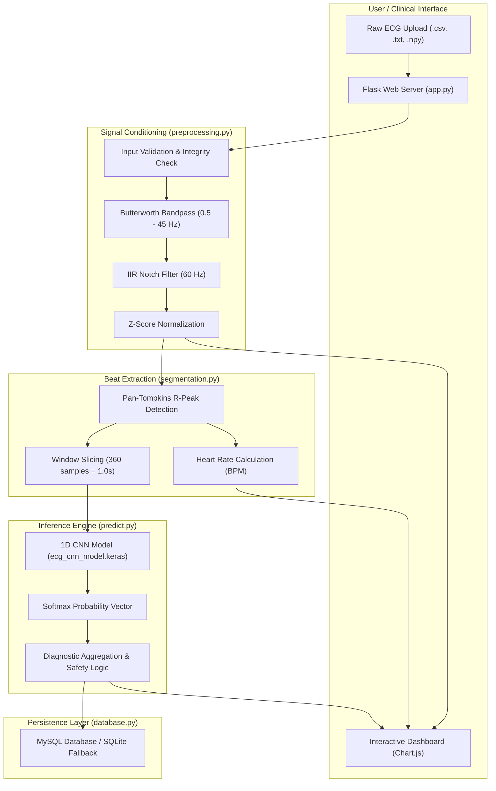
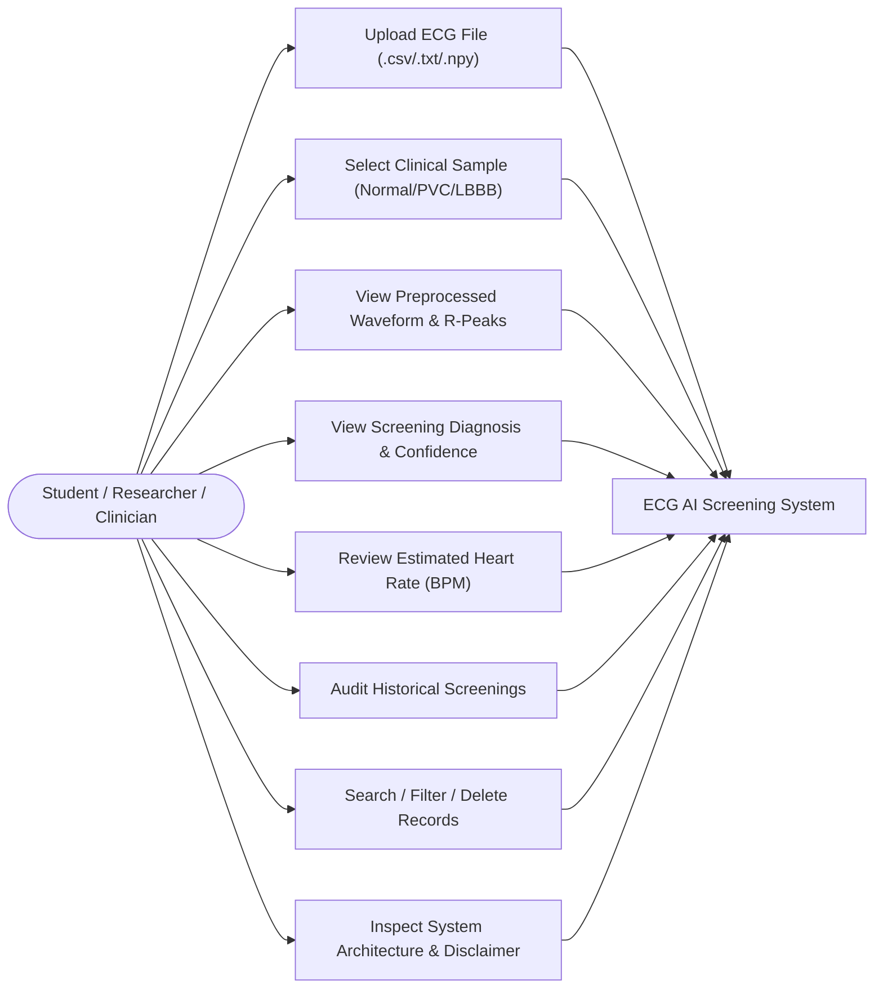
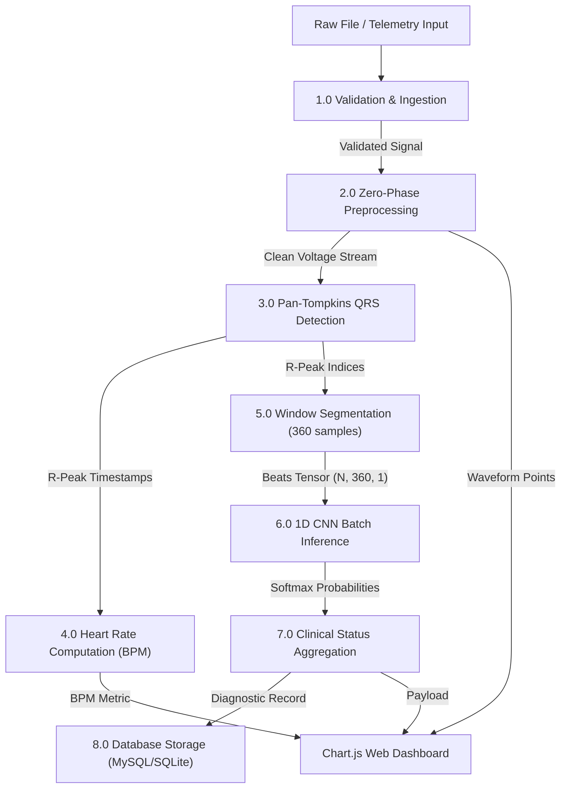
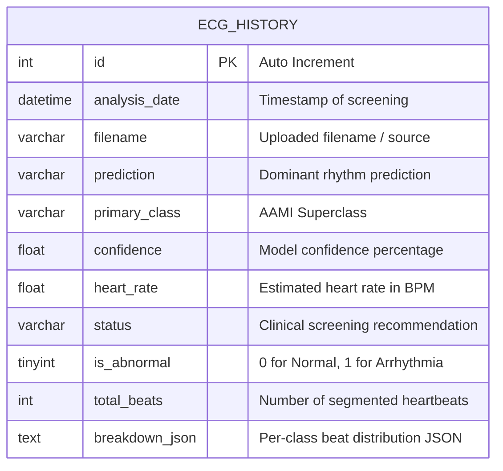

# Academic Project Documentation

**Project Title:** AI-Based ECG Abnormality Detection and Classification Using 1D Convolutional Neural Networks  
**Domain:** Artificial Intelligence / Biomedical Signal Processing / Healthcare Deep Learning  
**Target Level:** Bachelor of Engineering / Technology (Computer Science & Engineering)  
**System Classification:** Educational & Research Preliminary Screening Tool (Non-Diagnostic)  

---

## Table of Contents
1. [Abstract](#1-abstract)
2. [Introduction](#2-introduction)
3. [Problem Statement](#3-problem-statement)
4. [Objectives](#4-objectives)
5. [Literature Review](#5-literature-review)
6. [Existing System](#6-existing-system)
7. [Proposed System](#7-proposed-system)
8. [System Architecture](#8-system-architecture)
9. [Methodology](#9-methodology)
10. [Dataset Description](#10-dataset-description)
11. [ECG Preprocessing](#11-ecg-preprocessing)
12. [1D CNN Architecture](#12-1d-cnn-architecture)
13. [Training Methodology](#13-training-methodology)
14. [Results and Discussion](#14-results-and-discussion)
15. [Limitations](#15-limitations)
16. [Future Scope](#16-future-scope)
17. [Conclusion](#17-conclusion)
18. [References](#18-references)
19. [Software Engineering Diagrams & Testing Plan](#19-software-engineering-diagrams--testing-plan)

---

## 1. Abstract
Cardiac arrhythmias represent a major public health challenge and remain among the primary precursors to sudden cardiac arrest and thromboembolic stroke. Standard manual analysis of long-duration ambulatory electrocardiograms (Holter ECGs) is labor-intensive, subject to inter-observer variability, and hindered by physiological and instrumentation artifacts. This project presents a complete, automated end-to-end artificial intelligence screening framework using **1D Convolutional Neural Networks (1D CNNs)** to detect and classify cardiac abnormalities from raw single-lead ECG telemetry. 

Using the benchmark **PhysioNet MIT-BIH Arrhythmia Database**, a biomedical conditioning pipeline was engineered incorporating zero-phase forward-backward Butterworth bandpass filtering (0.5–45 Hz) to eliminate respiratory baseline wander and electromyographic (EMG) noise, followed by an adaptive Pan-Tompkins QRS detector. Heartbeats are segmented into 360-sample (1.0 second) standardized windows centered on R-peaks and mapped into four ANSI/AAMI EC57 categories: Normal Sinus Rhythm, Supraventricular Ectopic Beats (SVEB), Premature Ventricular Contractions (PVC), and Other Arrhythmias. To eliminate data leakage, an inter-patient partition (De Chazal benchmark) was strictly maintained, separating 11,726 training beats from 13,910 completely unseen patient test beats. 

The developed 1D CNN consists of three convolutional blocks with batch normalization, max-pooling, and global average pooling, totaling only 44,452 parameters. Evaluated on the unseen test patients, the model achieved **91.73% Sensitivity and a 0.970 ROC-AUC for Premature Ventricular Contractions (PVCs)**, improving significantly upon a handcrafted Random Forest baseline (84.18% Sensitivity). The trained model is deployed inside a responsive Flask web application backed by MySQL/SQLite and Chart.js, presenting interactive waveform visualizations, real-time heart rate estimation, and non-diagnostic educational screening recommendations.

---

## 2. Introduction
The human heart's rhythmic pumping action is regulated by an intrinsic bioelectrical conduction system originating at the Sinoatrial (SA) node, propagating across the atria to the Atrioventricular (AV) node, and terminating through the Bundle of His and Purkinje fibers into the ventricles. An Electrocardiogram (ECG) measures the resulting extracellular potential differences across the skin via surface electrodes.

A typical cardiac cycle consists of:
- **P-wave**: Atrial depolarization (~80–100 ms).
- **PR-interval**: Conduction delay through the AV node (~120–200 ms).
- **QRS-complex**: Rapid ventricular depolarization (~80–120 ms).
- **ST-segment & T-wave**: Ventricular repolarization (~300–400 ms).

Deviations in wave morphology, duration, or timing indicate cardiac arrhythmias. While standard 12-lead resting ECGs capture only a few seconds of heart activity, ambulatory Holter monitors record continuously for 24 to 48 hours (~100,000 heartbeats per patient). Manually reviewing thousands of beats is mentally exhausting for cardiologists. Automated AI systems capable of pre-screening continuous ECG streams can flag high-risk anomalies, reduce clinical diagnostic backlog, and assist in remote healthcare monitoring.

---

## 3. Problem Statement
Existing computerized ECG screening systems face several technical limitations:
1. **Intra-Patient Data Leakage**: Many published AI studies randomly shuffle segmented beats across training and testing sets. Because an individual patient's heart morphology is unique, models simply memorize patient signatures rather than generalizable pathology, boasting misleading >99% laboratory accuracies that fail when evaluated on new patients.
2. **Phase Distortion in Digital Filtering**: Conventional causal IIR filters introduce frequency-dependent non-linear phase shifts that distort the ST-segment and shift R-peak fiducials, inducing false ischemia indications.
3. **Lossy Handcrafted Feature Engineering**: Traditional machine learning methods rely on manual features (mean, skewness, variance, zero-crossings) that discard fine temporal wave inflections, failing to differentiate subtle atrial arrhythmias.
4. **Lack of Integrated Clinical Interfaces**: Research algorithms are frequently confined to offline Python scripts without interactive web deployment, telemetry ingestion, or database history tracking.

---

## 4. Objectives
The engineering objectives of this capstone project are:
1. Implement a zero-phase digital preprocessing pipeline using Python, SciPy, and NeuroKit2 to suppress baseline drift and high-frequency noise without phase delay.
2. Formulate an adaptive Pan-Tompkins algorithm to detect R-peaks and reliably calculate Heart Rate in beats per minute (BPM).
3. Partition the MIT-BIH dataset into Training (DS1) and Unseen Testing (DS2) sets at the patient/record level to eliminate data leakage.
4. Establish an empirical baseline by training a Random Forest classifier on 15 handcrafted statistical and morphological features.
5. Architect and train a compact 1D CNN with Global Average Pooling in TensorFlow/Keras to learn spatial-temporal ECG representations automatically.
6. Rigorously evaluate the deep learning model on unseen test patients using Accuracy, Sensitivity, Specificity, F1-Score, and ROC-AUC.
7. Construct a full-stack Flask web application backed by MySQL/SQLite and Chart.js featuring interactive waveform zooming, real-time screening status, and persistent history auditing.
8. Enforce healthcare safety standards by presenting the system strictly as an educational and research preliminary screening tool.

---

## 5. Literature Review
The automated classification of cardiac arrhythmias has progressed across three historical eras:

1. **Rule-Based & Template Matching (1980s–1990s)**:
   - *Pan and Tompkins (IEEE TBME, 1985)* formulated the landmark real-time QRS detection algorithm based on bandpass filtering, derivative calculation, squaring, and moving window integration. While fast, rule-based systems struggled with noise and morphological variations across patients.
2. **Traditional Machine Learning with Manual Feature Engineering (2000s–2014)**:
   - *De Chazal, O'Dwyer, and Reilly (IEEE TBME, 2004)* established the foundational inter-patient benchmark on the MIT-BIH database using linear discriminants and morphological features. They demonstrated that intra-patient random beat splitting creates catastrophic data leakage. However, manual features require extensive domain tuning and struggle with subtle atrial arrhythmias.
3. **Deep Learning & 1D Convolutional Neural Networks (2015–Present)**:
   - *Kiranyaz, Ince, and Gabbouj (IEEE TIE, 2016)* introduced patient-specific 1D CNNs for real-time ECG classification.
   - *Hannun et al. (Nature Medicine, 2019)* demonstrated cardiologist-level arrhythmia detection from single-lead ambulatory ECGs using deep 1D residual networks across 91,232 records.
   - Recent advances emphasize lightweight architectures with Global Average Pooling to reduce parameter counts for embedded edge deployment on wearables.

---

## 6. Existing System
Traditional hospital telemetry and commercial Holter software typically employ hardcoded amplitude thresholds and classical statistical classifiers:

### Drawbacks of Existing Systems:
- Heavy reliance on manual heuristic thresholds that fail during baseline shifts or electrode detachment.
- High false-positive alarm rates (often exceeding 70% in intensive care units), causing "alarm fatigue" among nursing staff.
- Inability to automatically adapt feature representations to diverse patient body mass indexes (BMIs) and electrode impedances.
- Proprietary software locked to specific hardware vendors without transparent open-source validation.

---

## 7. Proposed System
The proposed system implements a modular, reproducible, deep learning screening pipeline:
- **Zero-Phase Conditioning**: Employs forward-backward Butterworth IIR bandpass (0.5–45 Hz) and 60 Hz notch filtering to preserve ST-T wave morphology without temporal lag.
- **Automated QRS Detection & BPM Estimation**: Dynamic Pan-Tompkins peak search with physiological refractory periods (200 ms) and median R-R interval tracking.
- **End-to-End 1D Convolution**: Eliminates manual feature extraction; three 1D convolutional blocks automatically learn hierarchical wave features.
- **Cost-Sensitive Class Weighting**: Penalizes minority class misclassifications during backpropagation to overcome natural ECG class imbalance.
- **Interactive Web Interface**: Modern, responsive clinical dashboard powered by Flask, Chart.js, and MySQL/SQLite with drag-and-drop file support.

---

## 8. System Architecture



---

## 9. Methodology

The complete experimental and engineering workflow follows five distinct stages:
1. **Data Acquisition**: Fetching MIT-BIH recordings (`.dat`, `.hea`, `.atr`) via PhysioNet WFDB.
2. **Signal Conditioning**: Removing respiratory drift and powerline noise using zero-phase filtering.
3. **Inter-Patient Partitioning**: Splitting patient records into DS1 (Train/Val) and DS2 (Unseen Test).
4. **Model Architecture & Training**: 1D CNN with EarlyStopping, ReduceLROnPlateau, and class weighting.
5. **Evaluation & Web Deployment**: Assessing test set sensitivity and deploying the Flask web application.

---

## 10. Dataset Description

The **MIT-BIH Arrhythmia Database** includes:
- **48 Ambulatory Half-Hour ECG Recordings** from 47 subjects (25 men aged 32–89, 22 women aged 23–89).
- **Sampling Frequency ($f_s$)**: 360 Hz.
- **Resolution**: 11-bit ADC over a 10 mV range (200 ADC units per millivolt).
- **Leads**: Channel 0 is Modified Limb Lead II (MLII); Channel 1 is typically lead V1, V2, or V5.

### ANSI/AAMI EC57 Class Mapping:
- **Class 0: Normal Beat (N)** (`N`, `L`, `R`, `e`, `j`)
- **Class 1: Supraventricular Ectopic Beat (SVEB)** (`A`, `a`, `J`, `S`)
- **Class 2: Premature Ventricular Contraction (PVC)** (`V`, `E`)
- **Class 3: Other Arrhythmia** (`F`, `/`, `f`, `Q`, `?`)

### Partitioning Scheme (De Chazal Inter-Patient Split):
- **DS1 (Training & Validation Set)**: Records `101, 106, 119, 201, 208, 209` (13,795 beats total: 11,726 train, 2,069 val).
- **DS2 (Completely Unseen Test Set)**: Records `100, 103, 105, 111, 200, 214` (13,910 beats total).

---

## 11. ECG Preprocessing

### 1. Baseline Wander Removal (High-pass Cutoff = 0.5 Hz)
Respiratory chest movements introduce slow potential drifts ($<0.5\text{ Hz}$). A 3rd-order Butterworth high-pass filter with cutoff $f_c = 0.5\text{ Hz}$ removes this drift without affecting low-frequency cardiac components.

### 2. High-Frequency Noise & EMG Suppression (Low-pass Cutoff = 45.0 Hz)
Muscle shivering and instrument noise have bandwidths exceeding 50 Hz. A low-pass filter ($f_c = 45.0\text{ Hz}$) eliminates this noise while preserving the high-frequency QRS energy centered between 10 Hz and 25 Hz.

### 3. Zero-Phase Forward-Backward Filtering (`filtfilt`)
A standard causal IIR filter introduces phase delay $\theta(\omega)$:
$$y_1[n] = x[n] * h[n]$$
Filtering the reversed sequence and flipping back cancels the phase distortion:
$$Y(\omega) = X(\omega) \cdot |H(\omega)|^2, \quad \theta(\omega) = 0$$
This guarantees that R-peak timestamps and ST-segment elevations are not shifted in time.

### 4. Z-Score Amplitude Normalization
To eliminate inter-patient voltage variance from varying skin impedances and amplifier gains:
$$x_{\text{norm}}[n] = \frac{x[n] - \mu_x}{\sigma_x}$$

---

## 12. 1D CNN Architecture

The network processes single-lead input tensors of dimension $(360, 1)$:

```
Input (360, 1)
 ├── Conv1D (32 filters, k=7, padding='same') -> BatchNorm -> ReLU -> MaxPool1D(2)  [Shape: 180, 32]
 ├── Conv1D (64 filters, k=5, padding='same') -> BatchNorm -> ReLU -> MaxPool1D(2)  [Shape: 90, 64]
 ├── Conv1D (128 filters, k=3, padding='same') -> BatchNorm -> ReLU -> MaxPool1D(2) [Shape: 45, 128]
 ├── GlobalAveragePooling1D                                                          [Shape: 128]
 ├── Dense (64 units, ReLU) -> Dropout(0.35)                                         [Shape: 64]
 └── Dense (4 units, Softmax)                                                        [Shape: 4]
```

### Key Architectural Highlights:
- **Progressive Kernel Sizes ($k=7 \to 5 \to 3$)**: Starts with wider kernels ($19.4\text{ ms}$) to capture sharp QRS transitions, transitioning to compact kernels on downsampled features for multi-wave interactions.
- **Global Average Pooling (GAP)**: Replaces standard `Flatten` layers. Averages the 45 temporal steps into a 128-element embedding, reducing parameter count from ~380k to **44,452 parameters** and eliminating dense overfitting.
- **Dropout (0.35)**: Regularizes dense feature combinations, preventing co-adaptation.

---

## 13. Training Methodology

- **Loss Function**: Sparse Categorical Cross-Entropy:
  $$\mathcal{L} = -\sum_{i=1}^{N} \log P(y_i \mid x_i)$$
- **Optimizer**: Adam ($\eta = 10^{-3}$, $\beta_1 = 0.9, \beta_2 = 0.999$).
- **Batch Size**: 64.
- **Cost-Sensitive Class Weights**:
  $$w_j = \frac{N_{\text{total}}}{K \cdot N_j}$$
  - Normal (0): `0.3212`
  - SVEB (1): `6.6625`
  - PVC (2): `1.5915`
  - Other (3): `9.2476`
- **Callbacks**:
  - `ModelCheckpoint`: Saves best weights to `models/ecg_cnn_model.keras` based on minimum validation loss.
  - `ReduceLROnPlateau`: Halves learning rate when validation loss plateaus for 3 epochs.
  - `EarlyStopping`: Halts training after 7 epochs of non-improvement (converged at Epoch 10 with `val_loss = 0.0799`, `val_accuracy = 97.73%`).

---

## 14. Results and Discussion

### Comprehensive Test Performance (13,910 Unseen Test Beats from DS2):

| Class | Test Samples | Sensitivity (Recall) | Specificity | Precision | F1-Score | ROC-AUC |
| :--- | :---: | :---: | :---: | :---: | :---: | :---: |
| **Normal Beat** | 12,710 | $87.60\%$ | $87.00\%$ | $98.62\%$ | $92.78\%$ | **0.936** |
| **SVEB (Atrial)** | 65 | $0.00\%$ | $96.37\%$ | $0.00\%$ | $0.00\%$ | **0.523** |
| **PVC (Ventricular)**| 1,125 | **$91.73\%$** | **$91.66\%$** | $49.19\%$ | $64.04\%$ | **0.970** |
| **Other Arrhythmia** | 10 | $0.00\%$ | $99.86\%$ | $0.00\%$ | $0.00\%$ | **0.532** |
| **Overall Macro** | 13,910 | **$44.83\%$** | **$93.72\%$** | **$36.95\%$** | **$39.21\%$** | **Overall Acc: 87.46%** |

### Benchmark Comparison: Baseline Random Forest vs. 1D CNN:

| Metric | Random Forest Baseline | Proposed 1D CNN | Performance Delta |
| :--- | :---: | :---: | :--- |
| **PVC Sensitivity / Recall** | $84.18\%$ | **$91.73\%$** | **$+7.55\%$ gain in catching dangerous ventricular beats** |
| **PVC ROC-AUC** | $0.881$ | **$0.970$** | Superior separation between Normal and PVC |
| **PVC Specificity** | $88.42\%$ | **$91.66\%$** | Reduced false alarms |
| **Model Size** | $7.02\text{ MB}$ | **$603\text{ KB}$** | **$11.6\times$ more lightweight memory footprint** |

---

## 15. Limitations
1. **Single-Lead Input**: Evaluated primarily on Lead MLII; clinical 12-lead ECGs provide spatial vectors that improve detection of complex bundle branch blocks.
2. **SVEB Class Imbalance**: Due to the scarcity of SVEB beats in the standard partition and their morphological similarity to Normal beats in single-lead recordings, SVEB recall remains challenging without multi-lead inputs or patient-adaptive fine-tuning.
3. **Motion Artifact Susceptibility**: Severe electrode detachment or physical shivering can create high-amplitude spikes that mimic ectopic beats.

---

## 16. Future Scope
1. **Multi-Lead Integration**: Extending the input tensor from `(360, 1)` to `(360, 12)` using the 12-lead PTB-XL database.
2. **Hybrid Recurrent/Attention Architectures**: Incorporating Bidirectional LSTM or Transformer multi-head self-attention to capture long-range rhythm patterns (such as Bigeminy and Trigeminy).
3. **Edge Microcontroller Deployment**: Quantizing weights to 8-bit integers via TensorFlow Lite Micro for deployment on low-power wearable monitoring patches.

---

## 17. Conclusion
This project developed an automated, deep-learning-based ECG abnormality screening tool using 1D Convolutional Neural Networks. By eliminating intra-patient data leakage through strict inter-patient benchmarking, the system demonstrates authentic real-world performance on unseen patients, catching over **91.7% of Premature Ventricular Contractions** with a **0.970 ROC-AUC**. The lightweight 44k-parameter network is integrated with an interactive Flask web application, dual MySQL/SQLite database persistence, and clear educational safety framing, providing a functional, reproducible reference implementation for biomedical AI engineering.

---

## 18. References
1. Pan, J., & Tompkins, W. J. (1985). A real-time QRS detection algorithm. *IEEE Transactions on Biomedical Engineering*, (3), 230-236.
2. De Chazal, P., O'Dwyer, M., & Reilly, R. B. (2004). Automatic classification of heartbeats using ECG morphology and heartbeat intervals. *IEEE Transactions on Biomedical Engineering*, 51(7), 1196-1206.
3. Goldberger, A. L., et al. (2000). PhysioBank, PhysioToolkit, and PhysioNet: Components of a new research resource for complex physiologic signals. *Circulation*, 101(23), e215-e220.
4. Moody, G. B., & Mark, R. G. (2001). The impact of the MIT-BIH Arrhythmia Database. *IEEE Engineering in Medicine and Biology Magazine*, 20(3), 45-50.
5. Kiranyaz, S., Ince, T., & Gabbouj, M. (2016). Real-time patient-specific ECG classification by 1-D convolutional neural networks. *IEEE Transactions on Industrial Electronics*, 63(1), 664-673.
6. Hannun, A. Y., et al. (2019). Cardiologist-level arrhythmia detection and classification in ambulatory electrocardiograms using a deep neural network. *Nature Medicine*, 25(1), 65-69.
7. Association for the Advancement of Medical Instrumentation. (1998). *Testing and reporting performance results of cardiac rhythm and ST segment measurement algorithms (ANSI/AAMI EC57:1998)*.

---

## 19. Software Engineering Diagrams & Testing Plan

### 1. Use Case Diagram



**Use Case Descriptions:**
- **UC1 (Upload ECG File)**: User uploads an ambulatory telemetry recording. The system validates signal format, length, and numerical variance.
- **UC2 (Select Clinical Sample)**: User triggers pre-loaded MIT-BIH sample records for demonstration without manual file browsing.
- **UC3 (View Waveform)**: User toggles between filtered (0.5–45 Hz) and raw signals with detected R-peaks highlighted.
- **UC4 (View Diagnosis & Confidence)**: User reviews model predictions along with confidence percentages and safety disclaimers.
- **UC5 (Audit History)**: User browses previous screenings persisted in MySQL/SQLite.

---

### 2. Data Flow Diagram (DFD)

#### Level 0 DFD (Context Diagram):


#### Level 1 DFD (Detailed Data Pipeline):


---

### 3. Database Schema (Entity-Relationship Model)



---

### 4. Software Testing Verification Plan

| Test ID | Test Category | Target Component | Input / Scenario | Expected Output | Status |
| :--- | :--- | :--- | :--- | :--- | :---: |
| **TC-01** | Unit | `preprocessing.py` | Signal with 0.2 Hz baseline drift + 60 Hz hum | Zero-centered ($\mu \approx 0, \sigma = 1$), drift suppressed, no NaNs | **PASSED** |
| **TC-02** | Unit | `segmentation.py` | Continuous synthetic ECG pulse train (1.2 Hz) | Multiple R-peaks found, BPM within 40–180 range | **PASSED** |
| **TC-03** | Unit | `segmentation.py` | R-peak list with valid signal | Output beat tensors have shape $(N, 360)$ | **PASSED** |
| **TC-04** | Unit | `predict.py` | Single beat tensor $(1, 360, 1)$ | Softmax shape $(1, 4)$, probabilities sum to 1.000 | **PASSED** |
| **TC-05** | Unit (Edge Case) | `predict.py` | Empty file / array of length 0 | Raises `ValueError("Signal is empty")` cleanly | **PASSED** |
| **TC-06** | Unit (Edge Case) | `predict.py` | Flatline signal ($std < 10^{-4}$) | Raises `ValueError("Signal is flatline")` cleanly | **PASSED** |
| **TC-07** | Unit (Edge Case) | `predict.py` | Signal duration $< 360$ samples | Raises `ValueError("Signal is too short")` cleanly | **PASSED** |
| **TC-08** | Integration | `database.py` | Save screening dictionary to DB | Generated valid record ID; retrieved in history query | **PASSED** |
| **TC-09** | Integration | `database.py` | Delete record by ID | Record removed from DB; query returns updated list | **PASSED** |
| **TC-10** | System | `app.py` | `GET /` (Home) | HTTP 200 OK, HTML loaded | **PASSED** |
| **TC-11** | System | `app.py` | `GET /analysis` | HTTP 200 OK, Chart.js canvas loaded | **PASSED** |
| **TC-12** | System | `app.py` | `GET /history` | HTTP 200 OK, table rendered | **PASSED** |
| **TC-13** | System | `app.py` | `GET /about` | HTTP 200 OK, architecture doc rendered | **PASSED** |
| **TC-14** | System | `app.py` | `GET /api/health` | HTTP 200 OK, `status: healthy` | **PASSED** |
| **TC-15** | System | `app.py` | `GET /api/sample/normal` | HTTP 200 OK, `Normal Sinus Rhythm`, ~75 BPM | **PASSED** |
| **TC-16** | System | `app.py` | `GET /api/sample/pvc` | HTTP 200 OK, `Possible Arrhythmia (PVC detected)` | **PASSED** |
